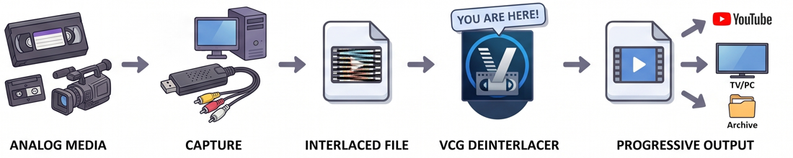

# VCG Deinterlacer

A Windows app for deinterlacing VHS, Hi8, MiniDV and other videotape captures
with QTGMC, the highest-quality software deinterlacer there is.

It measures your capture, tells you what it found and what it recommends doing
about it, and writes an archival master. Every recommendation can be
overridden, and every number behind one can be read.



## What it is for

A tape capture is not a finished file. The frames are interlaced, so they have
to be rebuilt into progressive ones. The capture card digitised more than the
picture, so there are black bars and a torn band at the bottom to remove. The
pixels are not square. The levels are often outside legal range, the colour
drifts, and the tape brought noise with it.

This tool does the structural work properly — once — so that what you keep is a
master you can edit, grade or archive from, rather than something you will want
to redo.

## The three modes

You choose the mode when you pick the file, because it decides which
measurements are even worth taking.

| Mode | What it does |
|---|---|
| **Just deinterlace** | Deinterlace, fix field order, crop the blanking, square the pixels, tag the colour. Nothing else is touched. |
| **Deinterlace + auto-fix** | The above, plus whatever the analysis recommends — denoising, dehalo, levels, colour. |
| **Full control** | The above, with eleven settings pages so you decide every filter yourself. |

**Just deinterlace** exists for people producing a master to grade elsewhere —
in DaVinci Resolve, or Topaz — who want the structural work done and nothing
else altered. It is enforced by test, not by convention: a run in that mode
cannot enable a single optional filter, including when you explore in Full
control first and then switch back down.

It is also much faster to analyse. Noise, halos, colour cast and chroma
bleeding are most of the analysis time, and nothing in Just deinterlace acts on
them, so those probes are skipped — about 2 seconds instead of 13 on a short
file, and proportionally more on a long tape.

## What it measures

Everything below is measured from your actual file, with the figures shown
beside each verdict:

- **Scan type** — interlaced video, or film that was telecined and should be
  inverse-telecined instead. Telecine is one possible answer, not the question.
- **Field order** — the single most consequential fact about an interlaced
  file. Fed the wrong one, QTGMC interpolates each field against the neighbour
  on the wrong side of it in time, and the result looks worse than the source.
  Most tape captures declare nothing, so it is measured from the picture.
- **Frame edges** — see automatic cropping, below.
- **Levels** — whether luma falls outside the legal 16-235 range.
- **Colour** — a consistent cast in U or V, and overall saturation.
- **Noise** — how much, and therefore how much denoising (if any) to suggest.
- **Edge halos** — oversharpening baked in by the deck or the capture chain.
- **Chroma bleeding** — colour smeared horizontally past its edges.
- **Audio** — how many real channels there are, so a mono recording captured as
  dual-mono, or one with a dead channel, is not silently carried through.

A measurement the app does not trust — too few usable frames, say — is never
acted on automatically, and says so.

## Automatic cropping

This is the part people are most surprised by.

Other tools offer fixed presets: BT.601 crops 8 columns from each side whatever
the file looks like. A real capture card does not oblige. The horizontal
blanking it digitises lands wherever the timing of that particular card, tape
and deck put it, so the black margin is routinely wider on one side than the
other. On one capture measured here it was 14 columns on *both* sides, which
means the 8-column preset leaves blanking inside the picture.

So the crop is measured off your own frames. Three different things sit at the
edge of a tape capture, and each gets its own test:

1. **Blanking** — flat and near-black. Brightness alone cannot find it, because
   a night scene is also near-black. What separates blanking is that it carries
   no *detail*, so a line counts only when it is both dark relative to the
   picture and flat relative to the picture.
2. **The analog edge ramp** — past the blanking, the picture does not begin
   abruptly; it ramps up over a few columns of dim, smeared video. A brightness
   threshold run across this eats into genuinely dark content. What separates a
   ramp is that it *climbs steadily inward*.
3. **The head-switching band** — the torn band in the last few lines of a VHS
   frame. It is not dark, so neither test above sees it. It is found instead by
   how unlike the line above each line is, in luma and especially in chroma:
   the band is torn out of sequence with the picture and its chroma phase is
   wrecked.

The result is a recommendation, shown with its numbers, on a page where you can
nudge each edge and watch the preview. Presets and a manual crop are still
there if you would rather set it yourself.

DV defaults to no crop, because DV uses all 720 samples as active picture.

## Deinterlacing

QTGMC runs at a deliberately **least-destructive** profile. Its only job here is
to rebuild the fields faithfully — not to clean, sharpen or stabilise, which are
separate, optional, visible steps.

| Setting | Value | Why |
|---|---|---|
| `Preset` | `Slower` | Quality baseline; higher presets give negligible visible gain |
| `TR2` | `1` | Light final temporal smoothing — the default of 2 acts as mild denoising |
| `SourceMatch` | `3` | Corrects the output back toward the original fields: the highest-fidelity mode |
| `Lossless` | `2` | Puts the real source fields back after resharpening |
| `Sharpness` | `0.1` | Effectively off; sharpening is not the deinterlacer's job |
| `Sbb` | `0` | No sharpness-limiting backblend |
| `MatchPreset` | `slow` | Accuracy for the source-match stage |
| `NoiseProcess` | `0` | QTGMC does no denoising at all |

Output is **double-rate**: 50 or 59.94 progressive frames a second, one per
field, so no motion is thrown away.

Two QTGMC implementations ship, and you can pick either:

- **havsfunc** — `havsfunc.QTGMC`, the long-standing reference implementation.
- **vs-jetpack** — `vsdeinterlace.QTempGaussMC`, the modern rewrite.

Both are driven from the same profile above, so the choice is between the two
libraries rather than between two sets of settings. Measured here they take
about the same time, and the rewrite carries slightly less fine vertical
detail. Neither benefits from a faster GPU, because the motion estimation
underneath QTGMC is CPU-only.

## Optional corrections and enhancements

In Full control each of these is a page of its own, with a before/after
preview:

**Trim** · **Levels** · **Colour tint** · **Noise** · **Halos** ·
**Colour bleeding** · **Upscale** · **Audio** · **Watermark** · **Dithering** ·
**Film grain**

A note on denoising, since it is the one most often asked about: QTGMC performs
none. When the Noise step is enabled it runs *after* the deinterlacer, on the
progressive frames. BM3D is the tool, and the script picks the fastest build
present on your machine — CUDA on an NVIDIA card, otherwise an AVX2 build about
four times quicker than the original, then the original, then KNLMeansCL, then
SMDegrain. Luma and chroma are both denoised, in two passes: luma with a
temporal radius, chroma spatially only, at half again the luma strength.
Chroma noise is a first-class VHS defect — colour is recorded as a
"colour-under" subcarrier down at 629 kHz, and it arrives soft *and* noisy.
Those are independent facts, and the softness is a reason to filter chroma
harder rather than leave it alone: there is little detail there to lose. The
chroma pass skips temporal matching, which is what smears colour.

## Output formats

Figures measured on two SD captures at 640x480 double-rate.

| | Codec | Bit rate | Per hour | Use it for |
|---|---|---|---|---|
| **Best for editing** | ProRes 422 HQ, 10-bit 4:2:2, in .mov | 103-110 Mbps | about 50 GB | An edit master. What editing software expects, and fast to scrub. Visually lossless, but a DCT codec. |
| **Highest quality** | FFV1 version 3, 8-bit 4:2:2, in .mkv | 71-83 Mbps | about 35 GB | Keeping. Mathematically lossless, and the archival community's choice. Smaller than the ProRes, which surprises people. |
| **Best for sharing** | H.264 High, 8-bit 4:2:0, in .mp4, x264 at CRF 18 | 2.7-3.3 Mbps | about 1.5 GB | Sending to someone. Plays anywhere; gives up the most. |

**All three formats are dithered on the way out.** The pipeline processes at
16-bit whatever the source was, so the deinterlacer and the filters have
precision to work in. Writing the file reduces that to the codec's depth — 10
bits for ProRes, 8 for FFV1 and H.264 — and error diffusion spreads the
rounding error so that a smooth gradient does not come out as visible bands.
The 8-bit formats discard more and need it most, but it applies to ProRes as
well. Ordered dithering, or none at all, are options on the Dithering page.

Sound is carried through as uncompressed 16-bit PCM in the two master formats,
and re-encoded to AAC only for H.264.

Colour is tagged rather than converted — BT.601 primaries, `smpte170m` for NTSC
or `bt470bg` for PAL. The one exception is upscaling to HD: an HD-sized frame is
read as BT.709 by players, so in that case the pixels really are converted, and
the tags follow them.

Each format's page carries the full detail behind these summaries, including
the trade that actually matters between the two masters — FFV1 is lossless but
8-bit, where ProRes is 10-bit through a DCT.

## What travels with the file

### Say what the recording actually is

Before you export, you can tell the app what is on the tape, and it writes that
*into the finished video* rather than into a note beside it:

| | |
|---|---|
| **What's on it** | "Grandma Jones at the 1998 Christmas party" |
| **When** | `1998-12-25` — the date of the event, not the date you digitised it |
| **Where** | "Toronto, Canada" |

This is for anyone digitising a family archive. A box of unlabelled tapes
becomes a folder of unlabelled files unless somebody writes down what they
were, and the person who knows is the person doing the capture — not whoever
opens the folder in thirty years. Putting it in the file means it survives
copying, emailing, re-muxing and being moved between drives, and it shows up in
Windows Explorer, in MediaInfo, in a player's info panel, and in a search
across the drive. A sidecar text file does none of that past the first time
someone reorganises.

All three fields are optional, and anything left blank writes nothing. The date
accepts a bare year or a year and month, so somebody who knows only that it was
the summer of 1998 is not forced to invent a day.

Written as `title`, `creation_time` plus `date`, and `location` — including the
Apple-style location key, so that .mov and .mp4 files read it as well as .mkv.

### And what was done to it

A restored tape outlives the memory of how it was restored, so the settings go
with it three ways, kept separate from the description above — a search for
"Christmas 1998" should not have to wade through deinterlacer settings:

- **A one-line summary in the file's own metadata** — survives copying,
  emailing and re-muxing, and is readable in MediaInfo or ffprobe without this
  app.
- **A JSON sidecar** — the complete configuration, which is what to reach for
  when you want to treat the next tape from the same deck identically.
- **A log** — what the tools actually said, for when something looks wrong.

The generated VapourSynth script is saved too, so the render is reproducible by
hand.

All three are written from the same configuration the render used, so none of
them can describe a setting that was not applied.

## Installing

Download the release, unzip it anywhere, and run the exe.

On first run it fetches a 158 MiB support payload containing FFmpeg, a portable
VapourSynth with its plugins, and the deinterlacing and denoising libraries.
The download is checked against a byte count and a SHA-256 compiled into the
app, extracted to a staging directory, and only swapped into place once it is
complete and verified — so a failed update cannot leave you without a working
install. Nothing is installed into your system Python, and no shell is spawned
to do it.

Requires 64-bit Windows 10 or 11.

## Building from source

```sh
cargo run --release -p vcg-gui
```

Or `run.cmd`, which builds the release binary if it is missing and launches it.

```sh
cargo test                  # the full suite
cargo clippy --all-targets  # clean, and kept clean in CI
```

The payload can be managed on its own:

```sh
cargo run --release -p vcg-deps --bin vcg-deps -- status --deps <DIR>
cargo run --release -p vcg-deps --bin vcg-deps -- install --deps <DIR>
```

`status` exits non-zero when the payload is not ready, so it can gate a script.

There is also a command-line prober that runs the same analysis and prints what
it found:

```sh
cargo run --release -p vcg-tools --bin vcg-probe -- "path/to/tape.avi"
cargo run --release -p vcg-tools --bin vcg-probe -- --quick "path/to/tape.avi"
```

## Built on

[QTGMC / havsfunc](https://github.com/HomeOfVapourSynthEvolution/havsfunc) ·
[vs-jetpack](https://github.com/Jaded-Encoding-Thaumaturgy/vs-jetpack) ·
[VapourSynth](https://www.vapoursynth.com/) ·
[FFmpeg](https://ffmpeg.org/) ·
[BM3DCUDA](https://github.com/WolframRhodium/VapourSynth-BM3DCUDA) ·
[egui](https://github.com/emilk/egui)

---

By [VideoCaptureGuide](https://videocaptureguide.com/).
